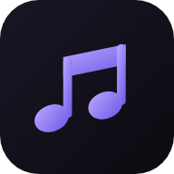
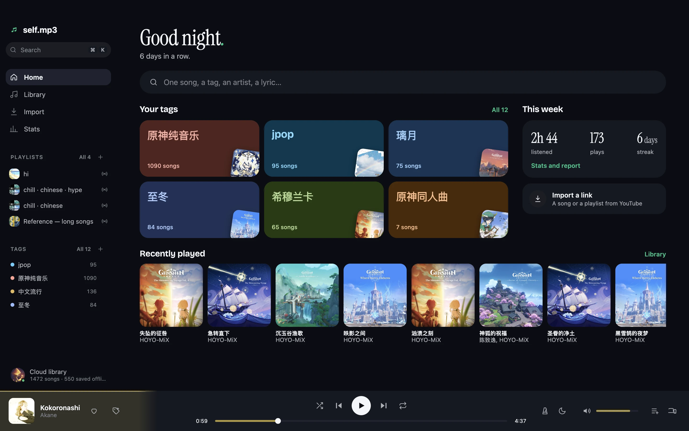
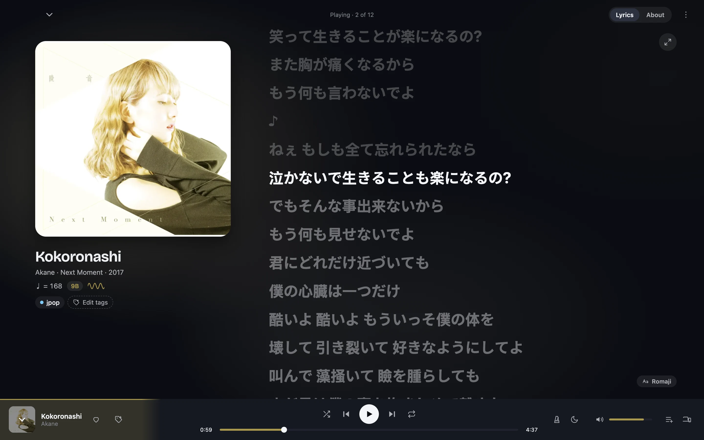
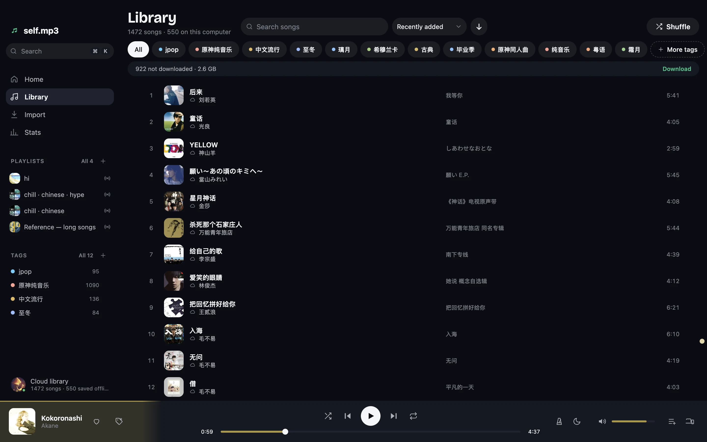
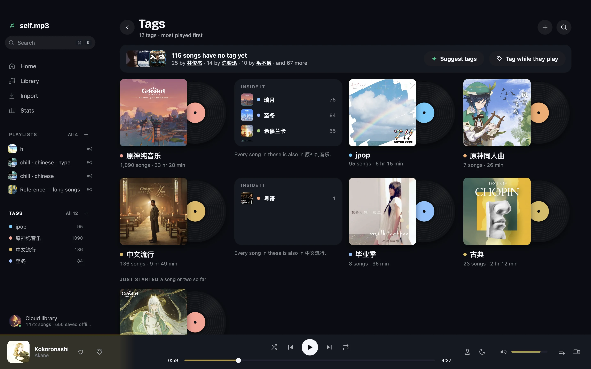
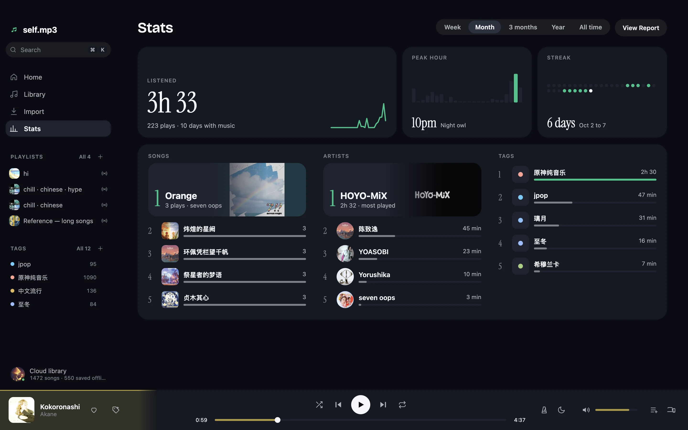
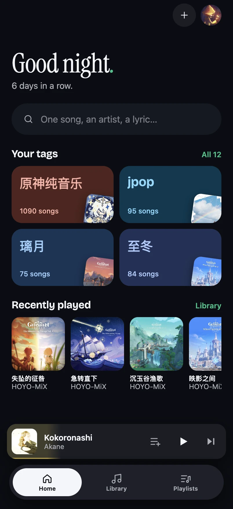
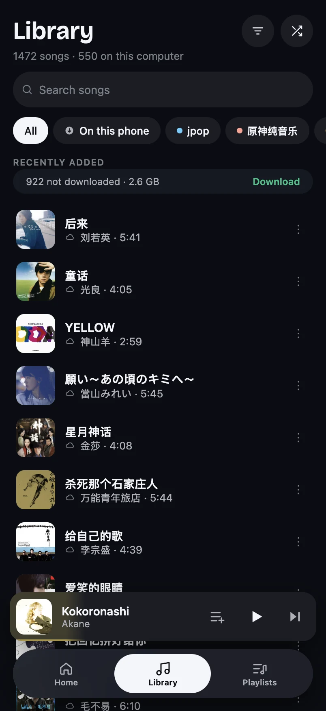
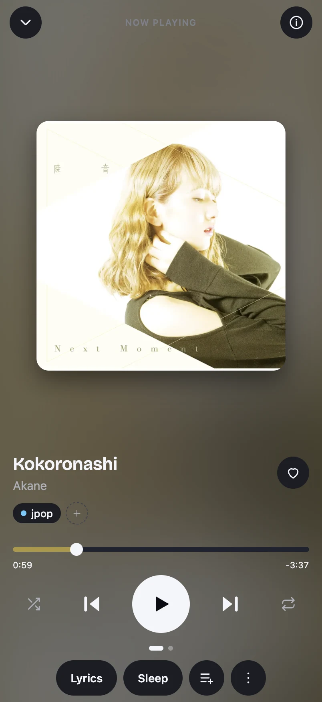

<p align="center">
  
</p>

<h1 align="center">self.mp3</h1>

<p align="center">
  A private music library you run yourself.<br>
  Import songs from a link, tag them your way, and play them on every device, with no signal if need be.
</p>

<p align="center">
  <a href="https://xiao215.github.io/selfmp3"><b>Open the web app</b></a> ·
  <a href="https://xiao215.github.io/selfmp3/install/">Get it on your phone</a> ·
  <a href="docs/INSTALL.md">Run your own server</a> ·
  <a href="docs/README.md">Docs</a>
</p>

<p align="center">
  <a href="https://github.com/Xiao215/selfmp3/actions/workflows/check.yml"></a>
</p>



Your music as files you own, not a catalogue you rent. There is no subscription and no
telemetry. You sign in with Google, and your library — every song, cover, lyric and play —
lives in a storage bucket of your own. A small server on an always-on computer imports and
analyses music into that bucket; your devices read it from there, so they keep working, and
keep their edits, when the server is out of reach.

It is made for one person, or a few friends.

---

## A look around

**Now playing**, with synced lyrics, tempo, key and tags beside the cover.



<table>
  <tr>
    <td width="50%"></td>
    <td width="50%"></td>
  </tr>
  <tr>
    <td><b>The library</b>, filtered by tag, sorted and searched on the device.</td>
    <td><b>Tags</b> instead of folders, each with its own colour.</td>
  </tr>
  <tr>
    <td></td>
    <td>
      
      
      
    </td>
  </tr>
  <tr>
    <td><b>Stats</b> for a week, a month, a year or all time.</td>
    <td><b>On a phone</b>, the same screens laid out for one hand.</td>
  </tr>
</table>

---

## What it does

**Bring music in**
- Paste a link, twenty links or a whole playlist. Check the names, listen and untick
  duplicates before anything downloads; titles like "YOASOBI「アイドル」 Official Music Video"
  arrive as アイドル by YOASOBI.
- Search YouTube Music and 网易云 by name, or bring in a Spotify playlist, a CSV or a plain
  list of songs ([import-sources](docs/features/import-sources.md)).
- From the share sheet on your phone, or a [Chrome extension](docs/features/browser-extension.md)
  button on the page you are looking at. When the server is out of reach, the link waits in
  your bucket until it is back.

**Keep it in order**
- [Tags](docs/features/tagging.md) instead of folders, playlists that fill themselves from
  tags, and an Up next you can save ([lists](docs/features/lists.md)).
- [Metadata](docs/features/metadata-polish.md) from iTunes and MusicBrainz: compare, then
  take only the fields you want.
- [Ask](docs/features/ai.md): play something, find songs, make a playlist, tidy names or tags,
  in words. It only ever proposes, from your own songs, and you approve. One switch turns it
  off.

**Listen**
- Gapless and crossfade, a sleep timer, and a [now-playing page](docs/features/now-playing.md)
  with synced lyrics, pinyin or romaji under Chinese and Japanese lines
  ([lyrics](docs/features/lyrics-plus.md)), and a Focus view of the words alone.
- Every song analysed for tempo, key and energy and heard by a listening model, for "Sounds
  like", smart playlists and an auto-mix that orders Up next into a smooth path
  ([audio](docs/features/audio-intelligence.md)).
- The [Sound map](docs/features/sound-map.md): the library as a night sky, placed by how it
  sounds. Tap a spot to play it, or draw a line and drift between two.

**Everywhere, and offline**
- A web app, an iPhone and Android app, and a Mac app, all the same app; the layout follows
  the width of the window.
- The phone and Mac apps download songs by themselves and play with no signal; plays made
  offline are sent later ([offline](docs/features/offline-sync.md)).
- Lock screen and Control Center, media keys, iOS widgets, Android Auto, and
  [handoff](docs/features/devices-and-handoff.md) between devices mid-song.

**With friends**
- [Listen together](docs/features/listen-together.md): your Up next becomes a room friends
  join with a link or a code, from a browser with only a name.
- [Share links](docs/features/share-links.md): send a song or a list; a friend plays it from
  your bucket for a while, with no account.

**Looking back**
- [Stats and the Report](docs/features/wrapped-and-gems.md) for any range, saved as an image,
  and forgotten gems: the songs you loved and stopped playing.

---

## Get it

| | |
|---|---|
| **In a browser** | [xiao215.github.io/selfmp3](https://xiao215.github.io/selfmp3). Sign in with Google, then connect your bucket ([set one up](https://xiao215.github.io/selfmp3/bucket.html), about ten minutes). Add it to the Home Screen for a full-screen app |
| **iPhone and Android** | [The install page](https://xiao215.github.io/selfmp3/install/), opened on the phone. Android downloads straight away; an iPhone sends its ID once, for the server's owner to add ([MOBILE.md](docs/MOBILE.md#sharing-the-iphone-app)) |
| **Mac** | A `.dmg` from the [releases page](https://github.com/Xiao215/selfmp3/releases), or `npm run build:desktop` ([INSTALL.md](docs/INSTALL.md#the-desktop-app)) |
| **Chrome** | `npm run build:extension`, then load `apps/extension/dist` unpacked ([browser-extension](docs/features/browser-extension.md)) |

Signing in asks for nothing else: there is no server address to type. Your devices join the
shared server by themselves the first time your bucket names none.

---

## Run your own server

The server belongs on a computer that is always on — a Raspberry Pi, a NAS, a small VPS —
with Docker. In a folder of its own, with this repository's
[`docker-compose.yml`](docker-compose.yml):

```bash
mkdir -p library data
docker compose up -d
```

It pulls `ghcr.io/xiao215/selfmp3` (arm64 and amd64), which carries yt-dlp and ffmpeg, so
there is nothing else to install. The image is rebuilt on every push to `main`, and weekly
for a fresh yt-dlp.

**[docs/INSTALL.md](docs/INSTALL.md)** has the rest: a public address with Tailscale Funnel,
every setting, the AI helper, your own doorman, running without Docker, backups and updating.

---

## How it works

```
  your devices                         Cloudflare                       Backblaze B2
┌──────────────────────┐   sign in,  ┌──────────────────────┐        ┌──────────────────────┐
│ the web app (Pages)  │   read and  │ the doorman          │        │ your bucket          │
│ iPhone / Android app │◄───────────►│ Google sign-in,      │◄──────►│ audio, covers,       │
│ desktop app          │   write     │ bucket access, rooms,│        │ lyrics, the snapshot,│
└──────────────────────┘             │ share links, grants  │        │ change log and plays │
           │                         └──────────────────────┘        └──────────────────────┘
           │ imports, Stats, Ask,               ▲
           │ metadata lookup, handoff           │ a grant from each account
           ▼                                    │
┌───────────────────────────────────────────────┴──┐
│ an always-on computer (a Raspberry Pi, here)     │
│ the selfmp3 server, in Docker: one workspace per │
│ signed-in account; imports, analysis, publishing │
│ cli-bridge beside it: the AI helper              │
└──────────────────────────────────────────────────┘
```

- **The bucket is the library.** Audio, covers, lyrics, the snapshot every device reads, the
  change log every device writes, and the plays. Keeping a backup means keeping a copy of the
  bucket ([SYNC.md](docs/SYNC.md)).
- **The server** imports, analyses and publishes. One server works for every account that
  signs in, each in a workspace of its own, and keeps nothing it could not get back from the
  bucket ([shared-server](docs/features/shared-server.md)).
- **The doorman**, a Cloudflare Worker, signs devices in and hands out bucket access, so no
  device holds the bucket's key ([apps/doorman](apps/doorman/README.md)).
- **One app** (`apps/app`, Expo) runs in a browser, on a phone and inside the Electron
  desktop app.

The decisions behind it are in [ARCHITECTURE.md](docs/ARCHITECTURE.md).

---

## Working on it

With Node 22 or newer:

```bash
npm install
npm run dev        # the server on :4600 and the web app on :4601, with a library of their own
npm run check      # every typecheck, lint and test — what CI runs
```

Every script, the habits that keep the repository in order and the CI workflows are in
[DEVELOPMENT.md](docs/DEVELOPMENT.md). All the documentation is indexed in
[docs/](docs/README.md).

---

## A note on importing

`yt-dlp` is a general-purpose downloader; self.mp3 drives it. Downloading from a service is
governed by that service's terms and by copyright law where you live, and a subscription
generally covers offline playback *inside that service's app* rather than extraction to your
own files. What you download and what you do with it is up to you; this tool assumes you are
keeping music you have the right to keep.

## Licence

MIT — see [LICENSE](LICENSE).
