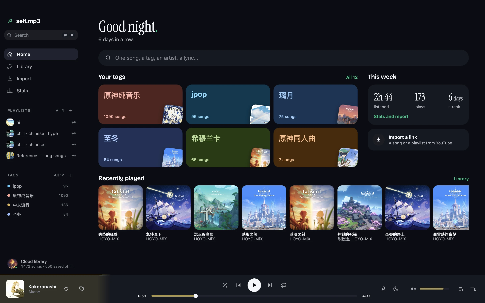
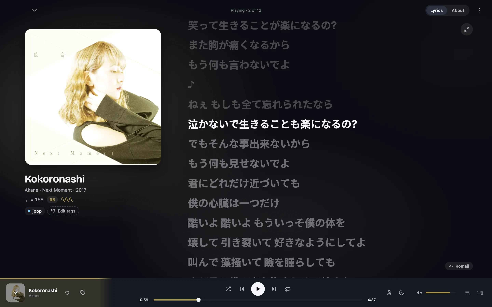
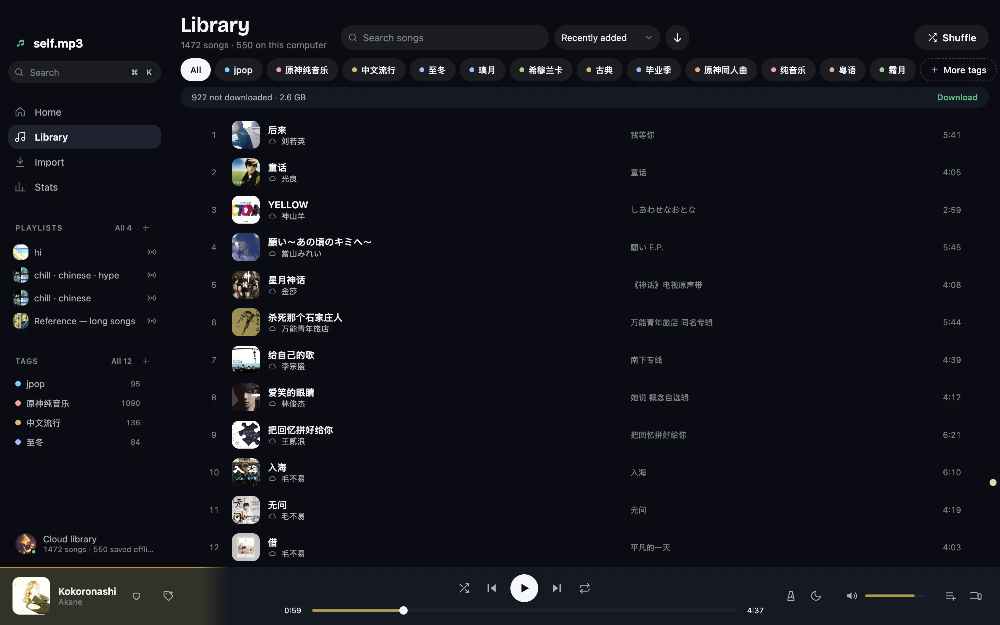
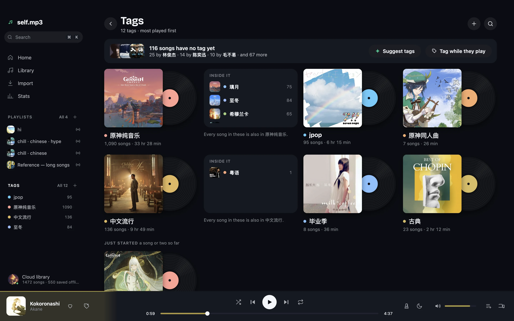
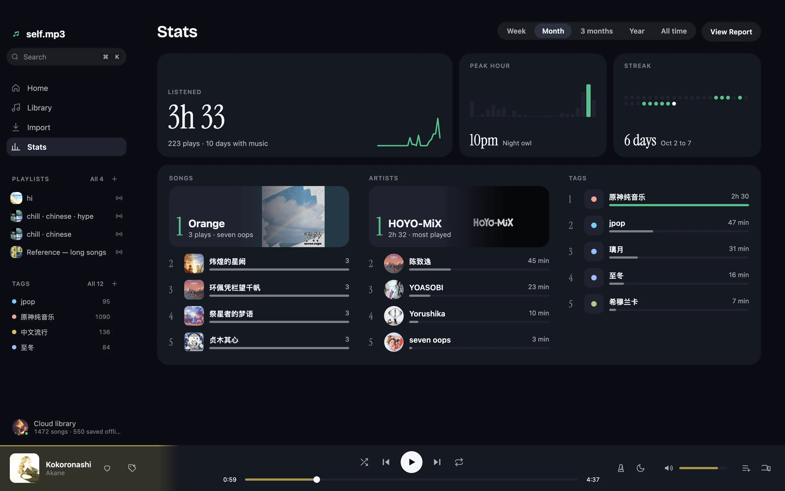
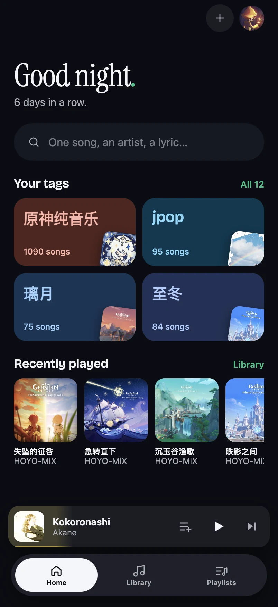
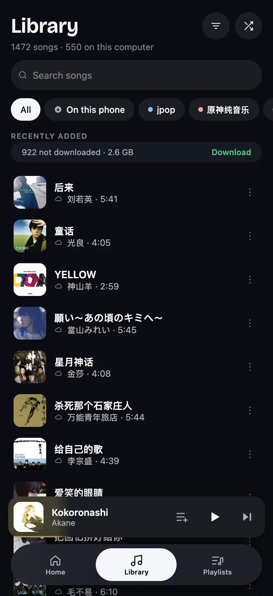
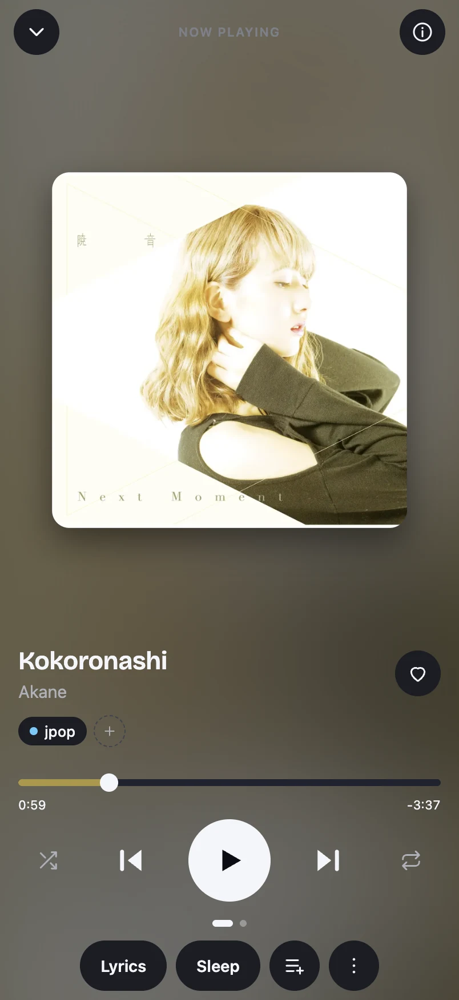

# self.mp3

[](https://github.com/Xiao215/selfmp3/actions/workflows/check.yml)

A private music library you run yourself. Import songs from a link or drop in files you
already have, tag them your way, and play them on your computer and your phone, with no
signal if need be.



It is for one person, or a few friends, who want their music as files they own rather than
a catalogue they rent. There is no subscription and no telemetry. You sign in with Google,
and your library — every song, cover, lyric and play — lives in a storage bucket of your
own. A small server on an always-on computer imports and analyses music into that bucket;
your devices read it from there, so they keep working, and keep their edits, while the
server is out of reach.

```
  your devices                         Cloudflare                       Backblaze B2
┌──────────────────────┐   sign in,  ┌──────────────────────┐        ┌──────────────────────┐
│ the web app (Pages)  │   read and  │ the doorman          │        │ your bucket          │
│ iPhone / Android app │◄───────────►│ Google sign-in,      │◄──────►│ audio, covers,       │
│ desktop app          │   write     │ bucket access, rooms,│        │ lyrics, the snapshot,│
└──────────────────────┘             │ share links, grants  │        │ change log and plays │
           │                         └──────────────────────┘        └──────────────────────┘
           │ imports, Stats, Ask,               ▲
           │ metadata lookup, handoff           │ a grant from each account
           ▼                                    │
┌───────────────────────────────────────────────┴──┐
│ an always-on computer (a Raspberry Pi, here)     │
│ the selfmp3 server, in Docker: one workspace per │
│ signed-in account; imports, analysis, publishing │
│ cli-bridge beside it: the AI helper              │
└──────────────────────────────────────────────────┘
```

The bucket is the source of truth. The server keeps a working copy of each library it
works for, and nothing it could not get back from the bucket.

## Contents

- [A look around](#a-look-around)
- [Where it runs](#where-it-runs)
- [What it does](#what-it-does)
- [Quick start](#quick-start)
- [Configuration](#configuration)
- [Development](#development)
- [How it is put together](#how-it-is-put-together)
- [Documentation](#documentation)
- [Backing up](#backing-up)
- [A note on importing](#a-note-on-importing)
- [Licence](#licence)

---

## A look around

A real library of 1,472 songs, in the desktop app.

**The song that is playing**, with its synced lyrics, tempo, key and tags beside the cover.



**The library**, filtered by tag, sorted, and searched on the device.



**Tags**, each a record with its own colour, and the tags that sit inside it.



**Stats** for a week, a month, a year or all time.



**At phone width**, as in the iPhone and Android app, the same screens laid out for one hand.

<p>
  
  
  
</p>

---

## Where it runs

Five pieces, each in its own place:

- **The server** (`apps/server`) runs on an always-on computer, in Docker: the image
  `ghcr.io/xiao215/selfmp3`, built for arm64 and amd64. Xiao's runs on a Raspberry Pi 4. It
  runs yt-dlp and ffmpeg, analyses each song, answers the questions only it can (Stats,
  metadata lookup, Ask, handoff) and publishes each library to its bucket.
- **The hub.** One server works for every Google account that signs in, each in a
  workspace of its own: its own database, inbox and import queue, publishing to that
  account's own bucket through a revocable grant. A device joins the shared server by itself
  the first time its bucket names none. See
  [shared-server.md](docs/features/shared-server.md).
- **The bucket** (Backblaze B2, one per account) holds the library: audio, covers, lyrics,
  the snapshot every device reads, the change log every device writes, and the play history,
  a file a month. See [SYNC.md](docs/SYNC.md).
- **The doorman** (`apps/doorman`, a Cloudflare Worker) signs devices in with Google, hands
  out bucket access so no device holds the bucket's key, keeps the list of who may sign in,
  and hosts listening rooms, shared playlists and share links. It is deployed by hand
  ([apps/doorman/README.md](apps/doorman/README.md)).
- **The AI helper.** The smart features call any OpenAI-compatible endpoint. Xiao's is
  [cli-bridge](https://github.com/Xiao215/cli-bridge), a small service on the same computer
  as the server (`127.0.0.1:8787`) that answers through the AI command-line tools signed in
  there. See [ai.md](docs/features/ai.md).

And one app (`apps/app`, Expo) that runs in a browser, on a phone and inside the desktop
app. The screens are the same everywhere; the layout follows the width of the window, not
the platform.

**Every device gets in the same way: sign in with Google, and the library is your
bucket's.** There is no server address to type anywhere; the app knows the shared server's
address as it knows the doorman's. The server's own page, on `:4600`, is not where you
listen: it is an admin page for the server.

| | Server | Browser tab | iPhone and Android app | Desktop app |
|---|---|---|---|---|
| **What it is** | Node, Express and SQLite in Docker on an always-on computer | The GitHub Pages build at `xiao215.github.io/selfmp3` | The Expo app, built yourself from this repo | An Electron window around the same web build, a `.dmg` on the releases page |
| **Holds the library** | A working copy per account, rebuilt from the bucket when lost | No | A copy of the bucket's library | A copy of the bucket's library |
| **Music with no signal** | — | Streams; keeps only the last few songs it played | Downloads, and plays from the files | Downloads, and plays from the files |
| **Import from a link** | Runs yt-dlp itself | Hands the link to the server when it can reach it, otherwise leaves the request in the bucket | The same | The same |
| **Stats, metadata lookup, Ask, handoff** | Answers them over `/api` | Asks the server directly when it can reach it, and says why when it cannot | The same | The same |
| **Controls outside the app** | — | The browser's media controls | Lock screen, Control Center, an iOS home-screen widget, Android Auto | Media keys, Now Playing in Control Center, the application menu |
| **Keyboard** | — | Space for play and pause | — | The application menu's shortcuts, and `⌘K` for Search |

On a phone the tabs are **Home · Library · Playlists**. Search opens from Home, and Profile
from Home's avatar; Profile leads on to Stats, Import, the Report and Settings. On a
computer those live in the sidebar.

---

## What it does

### Your library

**The bucket is the library.** Every song, cover and lyric lives in a storage bucket of your
own, and every device reads it from there. The server's folder is an inbox: an import lands
there, a file you drop there is imported too, and once a song is in the bucket the copy is
deleted. Filtering, sorting and search run on the device, so they are instant and work
offline. See [watched-library-folder.md](docs/features/watched-library-folder.md) and
[SYNC.md](docs/SYNC.md).

**Tags instead of folders.** One flat vocabulary you define. Combine tags, or leave one out.
Rename and recolour them in place, tag the song that is playing, and work through the songs
that have no tag yet from the Tags page. See [tagging.md](docs/features/tagging.md).

**Tags, playlists and Up next.** A tag's page is always that tag. A playlist is songs you
picked, or one that fills itself from tags. Up next is what you are listening to, named after
what you played, and **Save** turns it into a playlist. See [lists.md](docs/features/lists.md).

**Search, and pages for artists and songs.** One box finds places, songs and lines of
lyrics. An artist has a page of their own, and a song's page shows its details and the songs
that sound like it.

**Metadata that fixes itself.** Look a song up on iTunes or MusicBrainz, compare the
candidates with what you have, and apply only the fields you want. See
[metadata-polish.md](docs/features/metadata-polish.md).

**Select several, act once.** Tick songs and a bar appears to play them or add them to Up
next, with everything the song menu offers — tags, a playlist, removing them — in its More. See
[multi-select.md](docs/features/multi-select.md).

### Bringing music in

**From a link.** Paste one link or twenty, or a whole playlist. Metadata is fetched first,
so you can correct it, listen to a track and untick duplicates before anything downloads.
The queue lives in the server's database, so it survives a restart. Import can also search
YouTube Music and 网易云 for a song by name.

**And from anywhere.** Only the server can fetch a link, but you do not have to reach it to
add one. When it is out of reach, the link goes into the bucket with the tags and the
playlist you chose, and the server takes it the next time it looks; it arrives on your
devices with the sync after that.

**Titles arrive as song titles.** Where YouTube has no music metadata of its own, the
video's title is read as the song's: "YOASOBI「アイドル」 Official Music Video" comes in as
アイドル by YOASOBI. It drops what the video says about itself and keeps what belongs to the
song, so "(Live)", a "(From …)" note and a "feat." credit all survive (`tidyVideoTitle` in
`packages/shared/src/titles.ts`).

**From your phone's share sheet.** Share a track from the YouTube Music app and it queues on
the server: a share target on Android, a one-step Shortcut on iOS. See
[share-to-import.md](docs/features/share-to-import.md).

**From other services.** Liked Music, private playlists and artist pages import like any
other link once yt-dlp has YouTube cookies
([youtube-music-library.md](docs/features/youtube-music-library.md)). A 网易云音乐 link
downloads from 网易云 where it gives the whole song out; a Spotify link, a CSV export or a
plain list of song names has each song found on YouTube
([import-sources.md](docs/features/import-sources.md)).

**From the browser.** A Chrome extension imports the song you are looking at without
leaving the page: a button in the YouTube page, a popup with your tags and a playlist, and a
right-click item for any link. It is loaded unpacked from `apps/extension`. See
[browser-extension.md](docs/features/browser-extension.md).

### Listening

**Playback.** Gapless and crossfade in a browser and the desktop app, a reorderable Up next,
and a sleep timer.

**A page for the song that is playing.** Its artwork, what the app knows about it, and its
synced lyrics, Up next or details beside it. Focus turns the page into the words alone. A
song with no lyrics gets a visual instead that follows the actual sound and takes its
colours from the cover. See [now-playing.md](docs/features/now-playing.md) and
[now-playing-colour.md](docs/features/now-playing-colour.md).

**Lyrics.** Synced `.lrc` lyrics: tap a line to jump there. Found in a sidecar file, the
audio file's tags, YouTube Music's timed lyrics or lrclib.net, then kept. Chinese lyrics can
show pinyin and Japanese romaji underneath, and you can find a song by a line you remember.
See [lyrics-plus.md](docs/features/lyrics-plus.md).

**Audio it has actually listened to.** Every song is analysed on the server for tempo, key,
energy and loudness, and heard by a listening model for "Sounds like". That feeds rules for
playlists, similar songs, and an auto-mix that orders Up next into a smooth path. See
[audio-intelligence.md](docs/features/audio-intelligence.md).

**Smart features.** Ask in the Search box — play something, find songs, make a playlist,
tidy names or tags — and Describe it when making a playlist. The model only ever proposes,
from your own songs, and you approve. Each feature has its own switch in Settings. See
[ai.md](docs/features/ai.md).

### With friends

**Listening together.** Press Listen together beside the song that is playing and your Up
next becomes a room friends join with a link, a QR code or a code; a friend without
self.mp3 joins from a browser with only a name. Shared playlists are the lasting kind. See
[listen-together.md](docs/features/listen-together.md).

**Share links.** Send a song as a link; a friend plays it from your bucket for a while, with
no account. See [share-links.md](docs/features/share-links.md).

### Across your devices

**Offline, on the devices that keep songs.** The phone app and the desktop app download by
themselves, ask first on mobile data or past 500 MB, and mark every song that is on the
device. Plays made with no connection are sent later, dated when they happened. A browser
tab streams. See [offline-sync.md](docs/features/offline-sync.md).

**Handoff.** Devices that reach the server see what each other is playing. Move a song to
another device mid-track, or continue where you left off. See [devices-and-handoff.md](docs/features/devices-and-handoff.md).

**A desktop app, not a tab.** A Dock icon, the media keys, the application menu with `⌘K`
for Search, songs kept as files on the disk, and the keychain for its sign-in. See
[desktop-app.md](docs/features/desktop-app.md).

**A widget, and guides.** Two iOS home-screen widgets: your tags, and the song that is
playing ([widget.md](docs/features/widget.md)). A gesture nothing on screen shows is taught
once per device by a short spotlight guide ([guides.md](docs/features/guides.md)).

### Looking back

**Stats, and the Report whenever you want it.** Plays over time, when you listen, top
artists and tags, streaks, and how much you have never played. A report for any range —
week, month, year, all time — that you can save as an image. Forgotten gems brings back
songs you loved and stopped playing. The numbers are worked out by the server from the play
history, which it keeps in the bucket a month at a time, so a device asks the server for
them directly. See [wrapped-and-gems.md](docs/features/wrapped-and-gems.md).

---

## Quick start

The server belongs on a computer that is always on — a Raspberry Pi, a NAS, a small VPS —
with Docker. In a folder of its own, with the repository's
[`docker-compose.yml`](docker-compose.yml):

```bash
mkdir -p library data
docker compose up -d
docker compose logs -f
```

It pulls `ghcr.io/xiao215/selfmp3:latest`, which carries yt-dlp and ffmpeg, so there is
nothing else to install. To update, `docker compose pull && docker compose up -d`, by hand or
on a timer: the image is rebuilt on every push to `main`, and weekly for a fresh yt-dlp.

It runs on the host's own network, so it sees and publishes the computer's home and
Tailscale addresses. To reach it away from home, put Tailscale Funnel in front of it
(`tailscale funnel --bg 4600`) and set `SELFMP3_PUBLIC_URL` to that `https://` address in a
`.env` beside `docker-compose.yml` (copy `.env.example`). Then sign in with Google in
the [web app](https://xiao215.github.io/selfmp3), the desktop app or the phone app, and
connect your bucket in Settings.

The whole walkthrough — the Raspberry Pi, Tailscale, the bucket, the AI helper, the desktop
app and the phone — is in **[docs/INSTALL.md](docs/INSTALL.md)**. For the phone app, see
[MOBILE.md](docs/MOBILE.md); for the bucket, [SYNC.md](docs/SYNC.md).

The server also runs without Docker, on a Mac or a Linux machine with Node 22 or newer:
`./scripts/setup-mac.sh` installs yt-dlp and ffmpeg, builds, and offers to start the server
at login (`scripts/install-service.sh`, launchd or systemd), and `./scripts/doctor.sh`
checks the setup and tells you the command that fixes whatever is wrong.

---

## Configuration

Everything is optional; the defaults work. Set these in a `.env` beside
`docker-compose.yml`, which the container is handed, or in the environment; outside Docker,
in a `.env` at the top of the checkout. Copy `.env.example` to start; git ignores `.env`.
They are read in `apps/server/src/config.ts`.

| Variable | Default | Meaning |
|---|---|---|
| `SELFMP3_PORT` | `4600` | Port to listen on |
| `SELFMP3_HOST` | `0.0.0.0` | Bind address. The addresses the server finds on its network interfaces are how a device at home reaches it; `127.0.0.1` keeps it to this machine |
| `SELFMP3_PUBLIC_URL` | none | One more address to publish: the `https://` address of whatever stands in front of the server, such as a Tailscale Funnel. It also lets the web app's origin call the server |
| `SELFMP3_APP_URL` | `https://xiao215.github.io/selfmp3` | Where the app you listen in is published: the server's page links there, and with a public address its origin may call the server |
| `SELFMP3_LIBRARY_DIR` | `/app/library` in Docker; `~/Music/selfmp3` otherwise | The inbox: where an import lands until it is in the bucket. Each workspace has a folder of its own inside it |
| `SELFMP3_DATA_DIR` | `/app/data` in Docker; `~/Library/Application Support/selfmp3` on macOS, `~/.local/share/selfmp3` elsewhere | `hub.json`, each workspace's database and caches, and the listening model's files |
| `SELFMP3_PROFILE` | none | A separate installation outside Docker: `dev` uses `~/Music/selfmp3-dev` and a `selfmp3-dev` data folder. `npm run dev` sets it |
| `SELFMP3_AUTH_TOKEN` | one the server makes | The token of a server whose bucket is a folder. A server working for accounts gives each library its own, kept in `hub.json` |
| `SELFMP3_DOORMAN_URL` | the one in `packages/shared/src/cloud.ts` | The doorman the server signs in to the cloud through. Empty for none |
| `SELFMP3_CORS_ORIGINS` | none | Comma-separated origins allowed to call the API, beyond the desktop app, the extension and (with a public address) the web app. `npm run dev` adds the web dev server's, `http://localhost:4601` |
| `SELFMP3_AI_BASE_URL` | unset | An OpenAI-compatible endpoint for the smart features, such as cli-bridge's `http://127.0.0.1:8787/v1` ([ai.md](docs/features/ai.md)). Also `SELFMP3_AI_API_KEY`, `SELFMP3_AI_MODEL_FAST` and `SELFMP3_AI_MODEL_SMART` (both `sonnet`), and `SELFMP3_AI_TIMEOUT_SECONDS` (240). Unset, the smart features are off and say so |
| `SELFMP3_SOUND` | `true` | The listening model, which hears each song for "Sounds like" and for Ask. Its files, about 750 MB, are downloaded to the data folder the first time they are wanted. `false` turns it off |
| `SELFMP3_SOUND_MODELS` | the `sound-models-v1` release | Where the model's files come from: an address, or a folder that already holds them ([scripts/sound-models](scripts/sound-models/README.md)) |
| `SELFMP3_SOUND_THREADS` | `2` | CPU threads the model may use while it listens |
| `SELFMP3_LOG_LEVEL` | `info` | `debug`, `info`, `warn`, `error`, `silent` |
| `SELFMP3_SCAN_ON_BOOT` | `true` | Sweep the inbox at startup, so a file dropped in while the server was off is imported |
| `SELFMP3_CLOUD_DIR` | unset | A folder to use as the bucket instead of an account — the dev profile and the verify lanes run with one. Relative to the data folder unless absolute |
| `SELFMP3_PUBLISH_ANYWAY` | `false` | Publish this server's library to the bucket as it stands, without taking on the bucket's first or refusing to replace a bigger one. An escape hatch ([SYNC.md](docs/SYNC.md)) |

The bucket each account syncs with is connected in the app's Settings, and who may sign in
at all is kept by the doorman's owner in Settings › Who can sign in.

Day-to-day behaviour — crossfade, the watched folder, romanization, the smart features —
lives in the app's Settings rather than in the environment.

A few of the server's settings have no screen yet, so they sit at their defaults unless the
database is edited by hand: where yt-dlp gets YouTube cookies from (a browser or a cookies
file), the tags added to every import, and the automatic rescan interval.

**About the token.** Each library on the server has a token of its own, kept in
`<data>/hub.json`. You never type it: it goes into that account's bucket with the server's
addresses, and every device signed in to the account is handed it with the sync. A request
with no token from the server's own machine (its own page at `http://localhost:4600`, the
`selfmp3` command) goes to the only library when there is just one, because anyone at that
keyboard could read the token anyway.

---

## Development

On a development machine (a Mac, in Xiao's case), with Node 22 or newer:

```bash
npm install
npm run dev        # the server on :4600 with the dev profile, the app's web dev server on :4601
```

The dev profile keeps its own library and database, and uses a folder as its bucket, so
working on the code never touches a real collection. Every root script:

| Command | What it does |
|---|---|
| `npm run dev` | `dev:api` and `dev:web` together |
| `npm run dev:api` | The server with reload, on the `dev` profile with a folder for a bucket, letting the web dev server's origin (`:4601`) call it |
| `npm run dev:web` | Builds the packages, then the app's web dev server on `:4601` |
| `npm run dev:desktop` | The desktop app against a dev build |
| `npm run build:packages` | The four shared packages, in dependency order — every other build starts here |
| `npm run build` | The packages and the server — what `npm start` runs |
| `npm run build:desktop` | The app's web export, packaged as a `.dmg` in `apps/desktop/release/` |
| `npm run build:extension` | The packages and the browser extension, into `apps/extension/dist/` |
| `npm run zip:extension` | That build, zipped into `apps/extension/release/` |
| `npm start` | Run the built server |
| `npm run cli -- <command>` | The `selfmp3` CLI: `start`, `scan`, `import`, `backup`, `doctor` |
| `npm run typecheck` | TypeScript across the root project |
| `npm run typecheck:clean` | The same, from scratch — for when a stale `tsconfig.tsbuildinfo` makes it lie |
| `npm run typecheck:verify` | The three Playwright suites, which no other project checks |
| `npm run typecheck:app` | Builds the packages, then type-checks the app and its service worker |
| `npm run lint` / `npm run lint:fix` | ESLint, or ESLint with fixes |
| `npm run lint:app` | ESLint for the app |
| `npm run check:exports` | Exports nothing imports, twin-aware (`scripts/unused-exports.mjs`) |
| `npm run check:comments` | Files, `#member`s and mock boards a comment names but the repo no longer has (`scripts/comment-refs.mjs`) |
| `npm test` / `npm run test:watch` | The Vitest suite, once or watching |
| `npm run test:app` | The app's component tests (Jest) |
| `npm run check:app` | `typecheck:app`, `lint:app` and `test:app` |
| `npm run check` | Every typecheck, lint, format and test above, the app included — what CI runs |
| `npm run format` / `npm run format:check` | Prettier, writing or checking |
| `npm run verify:flows` | Playwright flows at computer and phone width, against `npm run dev` ([verify/README.md](verify/README.md)) |
| `npm run verify:desktop` | Playwright against the built desktop app |
| `npm run verify:extension` | Playwright against the built browser extension |
| `npm run clean` | Remove every build output |

Inside `apps/app`, `npx expo run:ios` or `npx expo run:android` builds the phone app; see
[MOBILE.md](docs/MOBILE.md). Phone flows run with Maestro ([apps/app/.maestro/README.md](apps/app/.maestro/README.md)).

A few habits keep this repository in order:

- Run `npm run check` before you commit. [`check.yml`](.github/workflows/check.yml) runs the
  same steps on every push and pull request, and the Pages, desktop and extension builds
  will not run without it.
- A schema change is a new migration appended to `apps/server/src/db/migrate.ts`. Never edit
  or renumber an existing one.
- A change to the API starts in `packages/shared`'s zod schemas; the compile errors then lead
  you to every place that needs updating.
- A push to `main` reaches the server within minutes, by way of the Docker image. The
  doorman does not: deploy it by hand after a change to `apps/doorman`.

---

## How it is put together

```
packages/shared          zod schemas (the API contract) and pure helpers: queue rules,
                         LRC parsing, fuzzy search, sync rules, audio feature distances
packages/client          what every client shares: API client, React Query hooks, the
                         download queue, auto-mix rules, theme tokens, platform ports
packages/replica         a device's own copy of the bucket's library, and its outbox
packages/desktop-bridge  the contract between the desktop shell and the page
apps/server              Express 5 and better-sqlite3: the hub, then routes → services →
                         repositories per workspace; public/ is its admin page on :4600
apps/app                 Expo / React Native: one app for iOS, Android and the web
apps/desktop             the Electron shell around apps/app's web export
apps/doorman             Cloudflare Worker: Google sign-in, bucket access, grants, rooms,
                         shared playlists and share links
apps/extension           the Chrome extension
```

The decisions that shape it — shared schemas instead of documented ones, storage behind an
interface, the bucket as the library, every play kept as a row, platform differences behind
ports — are explained in **[docs/ARCHITECTURE.md](docs/ARCHITECTURE.md)**.

Six GitHub workflows:

- [`check.yml`](.github/workflows/check.yml): typecheck, lint, format and tests on every
  push and pull request, and called by the three builds below before they run.
- [`e2e.yml`](.github/workflows/e2e.yml): the extension and desktop Playwright suites, on
  every push to `main` and every pull request.
- [`pages.yml`](.github/workflows/pages.yml): publishes the web app to GitHub Pages from
  `main`.
- [`docker.yml`](.github/workflows/docker.yml): publishes `ghcr.io/xiao215/selfmp3` for
  arm64 and amd64 on every push to `main` that touches the server, and weekly.
- [`desktop.yml`](.github/workflows/desktop.yml): builds the desktop app on a `desktop-v*`
  tag.
- [`extension.yml`](.github/workflows/extension.yml): zips the extension on an
  `extension-v*` tag.

The doorman is deployed by hand with `npx wrangler deploy` from `apps/doorman`
([apps/doorman/README.md](apps/doorman/README.md)).

---

## Documentation

| Document | What it covers |
|---|---|
| [docs/INSTALL.md](docs/INSTALL.md) | Running the server in Docker on a Raspberry Pi or another always-on computer, Tailscale, the AI helper, the desktop app, the CLI, backups and updating |
| [docs/SYNC.md](docs/SYNC.md) | The library in a bucket: the layout, signing in, how edits combine, setting it up |
| [docs/MOBILE.md](docs/MOBILE.md) | Building and running the iPhone and Android app, and Android Auto |
| [docs/ARCHITECTURE.md](docs/ARCHITECTURE.md) | How the code is laid out, and why |
| [docs/PREPROD.md](docs/PREPROD.md) | Checking a build against the real thing before calling it good: what to test on each platform, and how not to damage the library doing it |
| [docs/UI-MIGRATION.md](docs/UI-MIGRATION.md) | How the app was moved to the redesigned interface, phase by phase |
| [docs/FEATURE_TODO.md](docs/FEATURE_TODO.md) | What was planned or researched and is not built yet |
| [docs/CODE_TODO.md](docs/CODE_TODO.md) | What is left from the code audits, and what was kept on purpose so it is not reported again |
| [docs/ui-mock/README.md](docs/ui-mock/README.md) | The UI mock the interface is built to |
| [apps/doorman/README.md](apps/doorman/README.md) | Deploying the doorman, and what each setting means |
| [scripts/sound-models/README.md](scripts/sound-models/README.md) | Exporting the listening model's files |
| [verify/README.md](verify/README.md) | The Playwright flows and what they need |
| [apps/app/.maestro/README.md](apps/app/.maestro/README.md) | The phone flows, run with Maestro on a simulator |

Feature pages, each with what it does, how it works and where the code is:

| Feature | |
|---|---|
| [ai.md](docs/features/ai.md) | The smart features: Ask, Describe it, tidying names and tags, and the model behind them |
| [audio-intelligence.md](docs/features/audio-intelligence.md) | Tempo, key, energy and loudness; the listening model; similar songs; auto-mix |
| [browser-extension.md](docs/features/browser-extension.md) | The Chrome extension: the button, the popup, and what it asks Chrome for |
| [design-system.md](docs/features/design-system.md) | Dropdowns, popovers, hover captions, tokens and focus |
| [desktop-app.md](docs/features/desktop-app.md) | The desktop app: why it exists and how the shell is built |
| [devices-and-handoff.md](docs/features/devices-and-handoff.md) | Presence, handoff, continue where you left off |
| [guides.md](docs/features/guides.md) | One-time guides for gestures nothing on screen shows |
| [import-sources.md](docs/features/import-sources.md) | Importing from 网易云音乐, Spotify, or a list of song names |
| [install-and-ops.md](docs/features/install-and-ops.md) | The setup script, `doctor`, the CLI and the Docker image |
| [listen-together.md](docs/features/listen-together.md) | Rooms and shared playlists |
| [lists.md](docs/features/lists.md) | Tags, playlists and Up next: what each is, Save, Recently played |
| [lyrics-plus.md](docs/features/lyrics-plus.md) | Romanization, search by lyric, songs with no words |
| [metadata-polish.md](docs/features/metadata-polish.md) | iTunes and MusicBrainz lookups, finding missing covers |
| [multi-select.md](docs/features/multi-select.md) | Selecting songs and acting on them together |
| [native-app.md](docs/features/native-app.md) | The app on a phone, in brief |
| [now-playing.md](docs/features/now-playing.md) | The now-playing page, Focus, lyrics and the visual for songs with no lyrics |
| [now-playing-colour.md](docs/features/now-playing-colour.md) | The playing song marked in its cover's colour |
| [offline-sync.md](docs/features/offline-sync.md) | Automatic downloads and plays made offline |
| [share-links.md](docs/features/share-links.md) | Sending a song or a few as a link that ends by itself |
| [share-to-import.md](docs/features/share-to-import.md) | Importing from the share sheet on Android and iOS |
| [shared-server.md](docs/features/shared-server.md) | One server for every account: workspaces, grants, plays in the bucket, who may sign in |
| [tagging.md](docs/features/tagging.md) | Picking, editing and colouring tags, tagging what plays, songs with no tag |
| [watched-library-folder.md](docs/features/watched-library-folder.md) | The inbox folder, and sweeping it when it changes |
| [widget.md](docs/features/widget.md) | The iOS home-screen widgets |
| [wrapped-and-gems.md](docs/features/wrapped-and-gems.md) | The Report and forgotten gems |
| [youtube-music-library.md](docs/features/youtube-music-library.md) | Liked Music, private playlists and artist pages |

---

## Backing up

The bucket is the library: the audio, covers and lyrics, the snapshot every device reads,
and the play history, a file a month. Keeping a second copy of the library means keeping a
second copy of the bucket, with your storage provider's own tools.

The server keeps nothing it cannot get back. Each workspace's folders are a cache of its
bucket: delete one and the next start takes the library back from the bucket, plays
included. The one file of the server's own is `<data>/hub.json`, the list of who joined and
the token each library's devices hold; lose it and each account joins again from its next
device.

`npm run cli -- backup <dest-dir>` still copies the data and inbox folders, only what
changed, with each database copied through SQLite's backup API so the server can keep
running. More in [INSTALL.md](docs/INSTALL.md).

---

## A note on importing

`yt-dlp` is a general-purpose downloader; self.mp3 drives it. Downloading from a service is
governed by that service's terms and by copyright law where you live, and a subscription
generally covers offline playback *inside that service's app* rather than extraction to your
own files. What you download and what you do with it is up to you; this tool assumes you are
keeping music you have the right to keep.

---

## Licence

MIT — see [LICENSE](LICENSE).
